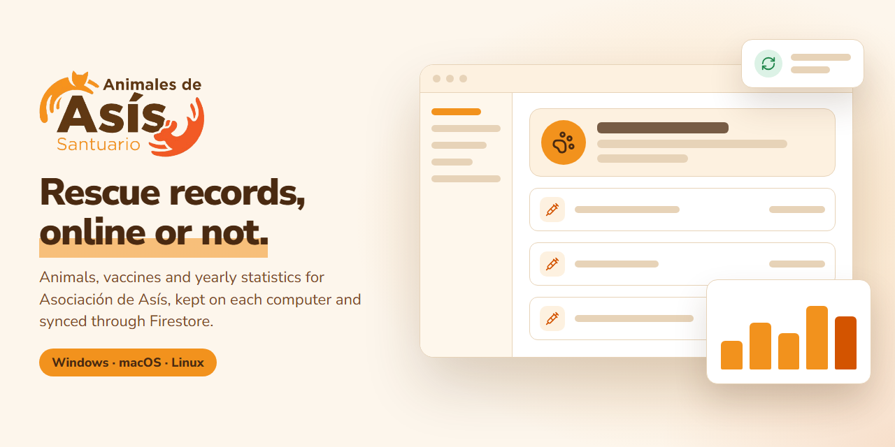
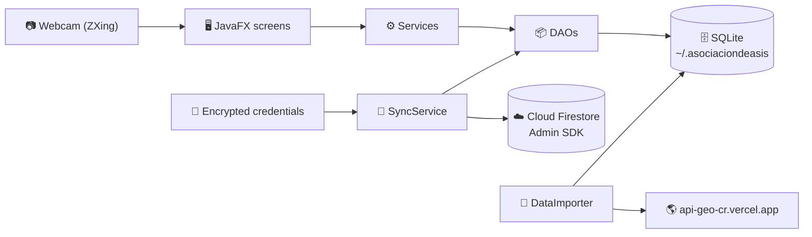

<p align="center">
  
</p>

<p align="center">
  <a href="https://github.com/Isma-L154/AnimalesDeAsis_DesktopApp/actions/workflows/workflow-CI.yml"></a>
  <a href="https://github.com/Isma-L154/AnimalesDeAsis_DesktopApp/actions/workflows/codeql.yml"></a>
  
  
  
</p>

<p align="center">
  <b>Desktop records for the rescued animals of <a href="https://animalesdeasis.com/">Asociación de Asís</a>, a shelter in Costa Rica.</b><br>
  Animals, vaccines and yearly statistics live on each computer and sync through Cloud Firestore when there is a connection.
</p>

<p align="center">
  <a href="https://github.com/Isma-L154/AnimalesDeAsis_DesktopApp/releases">Download</a> ·
  <a href="https://github.com/Isma-L154/AnimalesDeAsis_DesktopApp/issues">Report a bug</a> ·
  <a href="#running-locally">Run it locally</a>
</p>

---

## What it does

- **Works without internet** — every record is written to a local SQLite database first, so the shelter keeps working when the connection drops.
- **Complete animal records** — species, sex, approximate age, chip number, barcode, rescue reason, place of rescue, ailments, neutering date and adoption status.
- **Chip scanning with the webcam** — reads a barcode through the computer's camera into the record form or the search filter.
- **Vaccination history** — each vaccine with its name and date, attached to its animal.
- **A home panel that points at work** — animals in the shelter, adoptions this year, recent admissions, and the animals with no vaccine or no chip on record.
- **Yearly statistics** — admissions per month, origin of the animals, total admissions and adoption rate, exportable to CSV.
- **Printable records** — one animal's details and vaccination history as a PDF.
- **Sync between computers** — at startup and every 24 hours, through Cloud Firestore.

## How it works



**Local first.** Screens talk to services, services to DAOs, and DAOs only to
SQLite. On the first start, `DataImporter` fills the provinces and cantons of
Costa Rica from `api-geo-cr.vercel.app`, a public third-party API, and never
calls it again once they are stored.

**Sync.** `SyncService` runs at startup and then every 24 hours while the
application is open.

- **Pull** downloads only the animals changed since the previous sync, with
  their vaccines, so its cost follows what changed and not how many records
  exist. The first sync on a machine, and one every 30 days, reads everything.
- **Push** uploads unsynced local data and stamps each animal it touches with
  the server's time. Vaccines are a subcollection of their animal and stamp the
  animal when written, so one query finds both. That stamp is what the next
  pull on the other machines looks for.
- The most recent `last_modified` wins, so offline edits are not overwritten by
  older remote data. Deletions made offline are kept as tombstones until they
  reach Firestore.
- Only this application writes the stamp. A record edited in the Firebase
  console, or by an installation older than this behaviour, reaches the other
  machines at their next full read rather than at the next sync, so update
  every installation together.

**Credentials.** Sync needs a Firebase service-account key, shipped as an
encrypted bundle that the application opens with a passphrase from the
environment. Without the passphrase or the bundle, the application runs
local-only and its sync indicator reads *Solo local*.
[SECURITY.md](SECURITY.md) explains why and how to rotate the key.

Code lives under `src/main/java/com/asosiaciondeasis/animalesdeasis/`:
`Controller` (screens), `Service` (business rules and `SyncService`), `DAO`
(SQLite, Firestore and the geographic import), `Abstraccions` (the interfaces
between them), `Model`, `Config` (database, Firebase, credentials, wiring) and
`Util` (scanner, exporters, UI helpers).

**Stack:** Java 21 · JavaFX 21 · SQLite · Firebase Admin SDK (Cloud Firestore) · ZXing + webcam-capture · OpenPDF · Logback · Maven · jpackage

## Running locally

Needs **JDK 21**. CI uses Liberica Full JDK 21, which bundles JavaFX. The Maven
wrapper is included, so Maven does not need to be installed. Node is needed
only for the Firestore emulator tests.

From an IDE, run **`Main`**: pressing Run works with no launch configuration.

```bash
# Run the tests (JUnit + Mockito)
./mvnw test

# The same, including the tests that need a real Firestore
# (on Windows use ".\mvnw.cmd test")
npx firebase-tools emulators:exec --only firestore --project demo-animalesdeasis "./mvnw test"

# Run the application
./mvnw javafx:run

# Build a native installer for the current OS (Windows .exe / macOS .dmg / Linux .deb)
./mvnw clean package
./mvnw jpackage:jpackage      # output in target/installer/
```

| Variable | Description |
| -------- | ----------- |
| `ANIMALESDEASIS_CRED_KEY` | Passphrase that decrypts the Firebase credentials bundle. The same value on every machine that syncs; whoever encrypted the bundle has it. Without it the application runs local-only. |
| `FIRESTORE_EMULATOR_HOST` | Tests only. Set by `firebase-tools emulators:exec`; when it is absent, the two Firestore emulator tests are skipped. |

The application reads the process environment, not a `.env` file, so there is
no `.env.example`. `.env` files are git-ignored all the same, and the
passphrase must never be committed.

Local data lives in `~/.asociaciondeasis`. Pass
`-Danimalesdeasis.data.dir=<path>` to use another folder; the tests do this so
they never touch the real database.

### Enabling Firebase sync

1. In the Firebase Console, generate a service-account private key (JSON).
2. Choose a long random passphrase and export it. There is no default, and the
   tool refuses to run without one:
   ```bash
   export ANIMALESDEASIS_CRED_KEY='...'      # bash
   $env:ANIMALESDEASIS_CRED_KEY = '...'      # PowerShell
   ```
3. Encrypt the JSON into `src/main/resources/FireConfig/firebase-credentials.enc`:
   ```bash
   ./mvnw -q compile
   java -cp target/classes \
     com.asosiaciondeasis.animalesdeasis.Config.FirebaseCredentialsEncryptor path/to/service-account.json
   ```
4. Delete the plaintext JSON, and set the **same** passphrase as
   `ANIMALESDEASIS_CRED_KEY` on every machine that synchronises.

> **Upgrading?** Bundles from before the current format no longer open, and the
> application says so on startup. The service-account key they hold has to be
> **revoked**, not merely re-encrypted — see [SECURITY.md](SECURITY.md).

The application version is the `app.version` property in `pom.xml`.

The banner is drawn in `docs/brand/banner.html`. Regenerate it from the
repository root with
`npx -y playwright@1.63.0 screenshot --viewport-size "1280,640" "file:///<absolute path>/docs/brand/banner.html" docs/brand/banner.png`.

## Deployment

The application ships as native installers built by GitHub Actions
([`workflow-CI.yml`](.github/workflows/workflow-CI.yml)):

- **Every push and pull request to `main`** compiles and runs the full test
  suite inside the Firestore emulator.
- **Every push to `main`** also builds installers on Windows, macOS and Linux
  and replaces the rolling `latest` prerelease with them, versioned
  `1.0.<run number>`.
- **Pushing a `v*` tag** (for example `git tag v1.0.0 && git push origin v1.0.0`)
  publishes the installers as a permanent, versioned GitHub Release. Tags must
  be strictly numeric (`v1.2.3`); jpackage rejects suffixes such as `-rc1`, and
  the workflow fails early when it sees one.

| Secret | Contents |
| ------ | -------- |
| `FIREBASE_CREDENTIALS_ENC` | Base64 of `firebase-credentials.enc`. Optional: without it, installers build in local-only mode. |

The passphrase is not a CI secret: it is needed where the application runs,
not where it is built. See [SECURITY.md](SECURITY.md).

## Security

- **Secrets stay out of the repository.** The service-account JSON and the
  encrypted bundle are git-ignored and have never been committed; CI injects
  the bundle from a secret.
- **The bundle is authenticated encryption.** AES-256-GCM with a key derived
  by PBKDF2-HMAC-SHA256 (random salt, 210,000 iterations). There is no built-in
  passphrase: without one the application refuses to decrypt and runs
  local-only.
- **SQL uses bound parameters** in every DAO, never concatenated values.
- **CI runs with least privilege.** Every workflow starts from
  `permissions: {}`, actions are pinned to commit SHAs, and Dependabot updates
  both the Maven dependencies and the actions weekly.
- **CodeQL** (`security-and-quality`) runs on every push and pull request to
  `main`, and weekly.
- **Credential code has a named owner** in [CODEOWNERS](.github/CODEOWNERS).
- **Known limit:** a desktop application has to carry what opens the bundle,
  and the Admin SDK bypasses Firestore security rules. [SECURITY.md](SECURITY.md)
  describes the risk and the two ways to remove it.

To report a vulnerability, see [SECURITY.md](SECURITY.md).

## License

[MIT](LICENSE) © 2025 Ismael Leon
